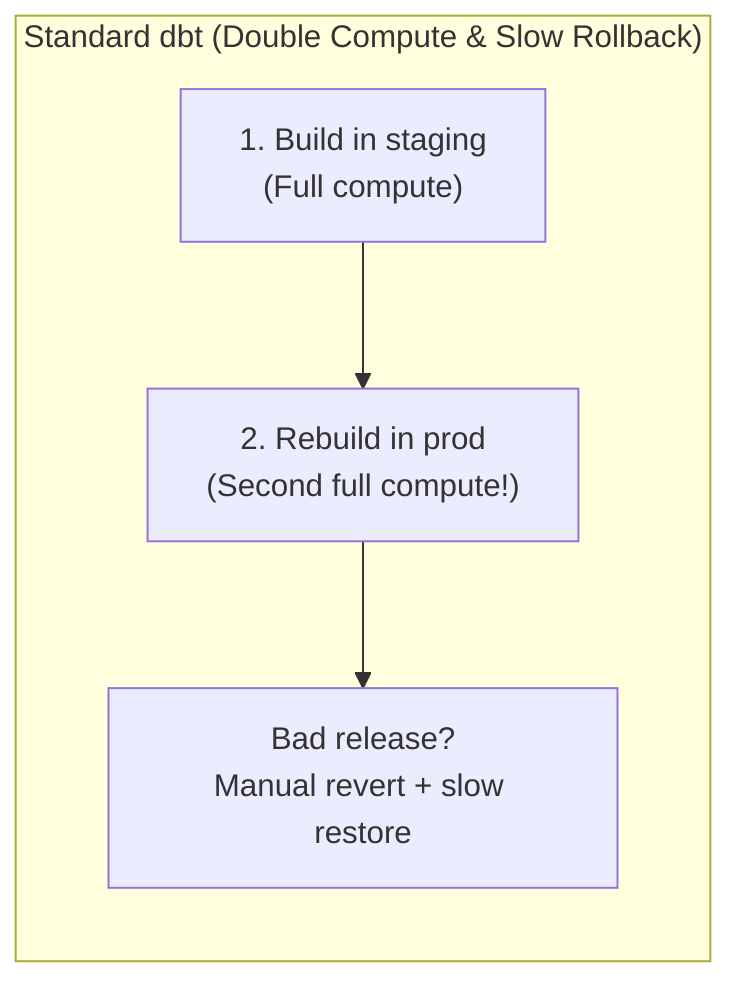
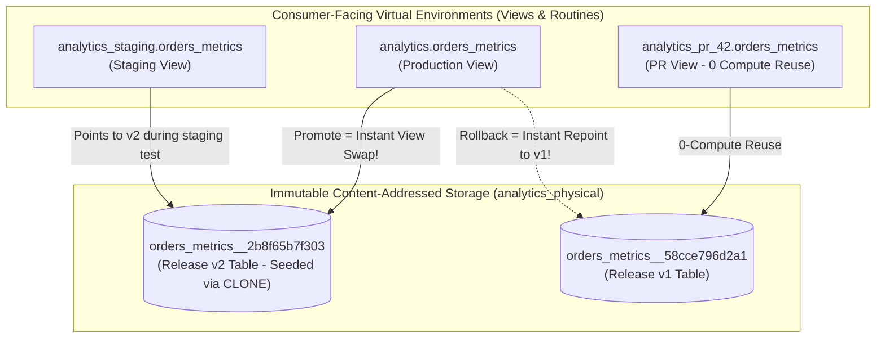

# `dbt-virtual` Documentation

**SQLMesh-style Virtual Data Environments for dbt** (first-class **BigQuery** + **Snowflake**, **DuckDB**, **PostgreSQL**, and **Databricks**) — `sqlglot` AST Merkle-DAG fingerprinting (`<model>__<fp>`), zero-copy `CLONE` incremental seeding with post-clone column migration, per-environment routine virtualization (`table_function`, `function`, `procedure`), pre-promotion quality gates (`audit`), concurrency lease locks (`_locks`), interval tracking (`_intervals`), zero-rebuild view-swap promotion (with partial promotion & automatic demotion), and instant rollback.

-   :material-rocket-launch:{ .lg .middle } **Step-by-Step Getting Started**

    ---

    Install `dbt-virtual` in 5 minutes, wire up `dbt_project.yml` and routing macros, and run your first virtual environment build and zero-rebuild promotion.

    [:octicons-arrow-right-24: Getting Started Guide](guides/getting_started.md)

-   :material-database-import:{ .lg .middle } **Migrating an Existing Project ($0 Compute)**

    ---

    Already have huge multi-TB production tables? Use `dbt-virtual adopt` to zero-copy `CLONE` existing tables into `analytics_physical` with zero rebuild cost.

    [:octicons-arrow-right-24: Migration Guide](guides/migrating_existing_project.md)

-   :material-tune:{ .lg .middle } **Configuration & Parameters Reference**

    ---

    Every parameter in `vars.dbt_virtual` (`physical_schema`, `environment`, `base_environment`, `ref_resolution`, `env_schemas`, `retention_releases`, `retention_days`) and model-level `config(...)` explained with examples.

    [:octicons-arrow-right-24: Configuration Reference](guides/configuration_reference.md)

-   :material-sitemap:{ .lg .middle } **How It Works & Architecture**

    ---

    Visualizing the Physical Layer (`analytics_physical`) vs Virtual Layer (`analytics_staging`, `analytics`), Merkle-DAG fingerprinting, and `ref_resolution` modes.

    [:octicons-arrow-right-24: How It Works](guides/how_it_works.md)

-   :material-console:{ .lg .middle } **CLI & Lifecycle Operations**

    ---

    Complete command reference for `plan`, `build`, `diff`, `audit`, `promote`, `rollback`, `status`, `init-env`, `drop-env`, `gc`, and `dbt run-operation` macros.

    [:octicons-arrow-right-24: CLI & Operations](guides/cli_and_operations.md)

-   :material-function-variant:{ .lg .middle } **Routines & TVF Unit Testing**

    ---

    Virtualizing BigQuery & Snowflake `table_function`, `function`, and `procedure` objects in strict tier order (`1 -> 2 -> 3 -> 4`) plus isolated unit testing with `tvf_test_ref`.

    [:octicons-arrow-right-24: Routines & TVF Testing](guides/routines_and_tvf_testing.md)

-   :material-database:{ .lg .middle } **Multi-Warehouse Support**

    ---

    First-class **BigQuery** support alongside **Snowflake**, **DuckDB**, **PostgreSQL**, and **Databricks** via `adapter.dispatch`.

    [:octicons-arrow-right-24: Warehouse Support Matrix](guides/warehouse_support.md)

---

## What Problem Does `dbt-virtual` Solve?

In traditional dbt projects, environments (`staging`, `prod`, PR schemas) are **physically coupled** to their target schemas:

With **`dbt-virtual`**, physical data is stored once in an immutable, content-addressed schema (`analytics_physical.<model>__<fingerprint>`), while environments (`staging`, `prod`, `pr_42`) are lightweight **virtual view & routine layers**:

---

## Key Capabilities Summary

| Feature | How `dbt-virtual` Implements It |
|---|---|
| **Merkle-DAG Fingerprinting** | Canonicalizes compiled SQL via `sqlglot` AST + strips target schema names so compiling under `staging` vs `prod` yields the **exact same 12-char SHA-256 fingerprint**. Upstream changes propagate automatically. |
| **Zero-Compute `REUSE`** | If a model's fingerprint already exists in `analytics_physical`, `dbt-virtual build` skips running it in dbt and simply points the environment's view at the existing physical table. |
| **Zero-Copy `CLONE` Incremental Seeding** | When an incremental model's SQL changes, `clone_if_new_fp()` automatically executes `CREATE TABLE new_fp CLONE prod_fp` before dbt's incremental merge runs—so you only process the new partition delta instead of a full refresh. |
| **Post-Clone Schema Evolution** | Supports `virtual_add_columns` in model config to emit `ALTER TABLE ... ADD COLUMN IF NOT EXISTS` immediately after cloning from `prod`. |
| **Tiered Zero-Rebuild Promotion** | `dbt-virtual promote` verifies all physical tables exist, optionally runs `virtual_audit` row-count quality gates, skips unchanged fingerprints (partial promotion), deploys in strict dependency order (**Tier 1 UDFs → Tier 2 Views → Tier 3 TVFs → Tier 4 Procedures**), and automatically drops obsolete views/routines deleted from the release. |
| **Instant Rollback** | `dbt-virtual rollback` restores all views and routines in `prod` to the previous release recorded in `analytics_physical._releases` in seconds. |
| **Concurrency Leases & Intervals** | `_locks` prevents simultaneous promotions/builds on the same environment, and `_intervals` tracks `[start_ts, end_ts]` backfill coverage per fingerprint. |
