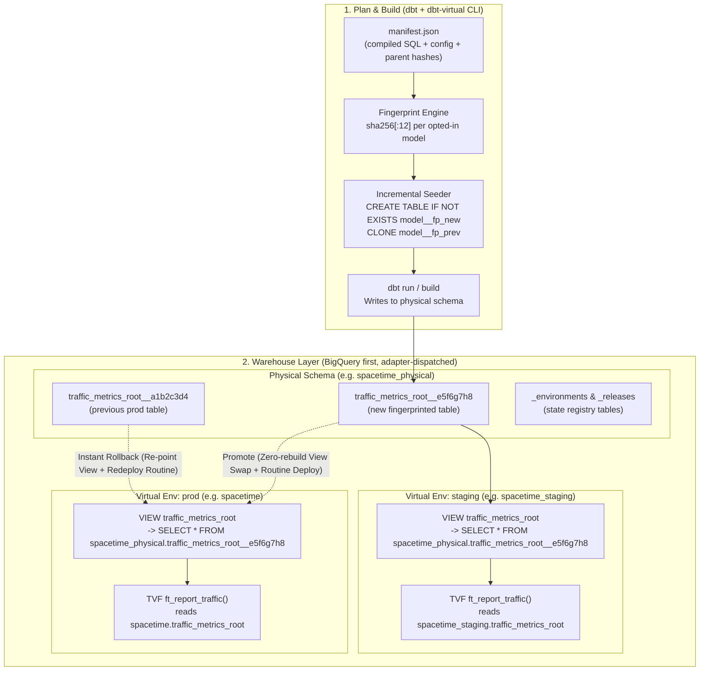

# `dbt-virtual` — Architecture & Technical Specification (v1.0)

- **Repository**: [`Flip-to/dbt-virtual`](https://github.com/Flip-to/dbt-virtual)
- **Status**: Draft v1.0
- **License**: Apache-2.0
- **Origin**: Generalized from `Flip-to/flipto-dbt#509` (Part 4: Virtual Environments in dbt & ADR `20261026_keep_dbt_build_virtual_environments.md`)
- **Packaging**: Hybrid — dbt Hub Macro Package (`dbt_virtual`) + lightweight Python CLI (`dbt-virtual`)

---

## 1. Problem & Motivation

Teams running **dbt on BigQuery (or Snowflake/Databricks)** face three structural limitations in standard dbt deployments:

1. **Promoting `staging` → `prod` requires rebuilding everything**: Even when staging has already built and tested a model against real data, promoting to production requires running `dbt build` a second time in production—paying double warehouse compute and risking data drift between the staging run and the production run.
2. **Rollback is slow and incomplete**: Rolling back a bad production run requires restoring tables from time travel or clones, while **BigQuery routines (`TABLE FUNCTION`, `FUNCTION`, `PROCEDURE`) have no time travel at all**.
3. **Adopting SQLMesh is often incompatible with existing dbt ecosystems**: SQLMesh introduced *Virtual Data Environments* (content-addressed physical tables `<model>__<fingerprint>` + per-environment view layers), where promotion and rollback are instant metadata-only view swaps. However, running an existing dbt project inside SQLMesh breaks custom Jinja materializations (`table_function`, `function`, `procedure`), `snowplow_unified` manifest hooks, `dbt-checkpoint`, the `sqlfluff` dbt templater, Elementary, and Slim CI.

**`dbt-virtual`** brings SQLMesh-style Virtual Data Environments natively into dbt—without migrating engines or giving up dbt's ecosystem.

---

## 2. Goals & Non-Goals

### Goals
- **Content-addressed physical tables**: Build each version of an opted-in model once into `<physical_schema>.<model>__<fp>`, where `<fp>` is a deterministic Merkle-DAG fingerprint of the compiled SQL, materialization config, and upstream fingerprints.
- **Zero-copy `CLONE` seeding for incrementals**: When an incremental model receives a new fingerprint, automatically seed `<model>__<fp_new>` via zero-copy `CREATE TABLE ... CLONE` from the active production fingerprint before running the incremental update.
- **Per-environment virtual view layer**: Maintain one virtual view per model per environment (`<env_schema>.<model>` → `SELECT * FROM <physical_schema>.<model>__<fp>`).
- **First-class routine virtualization**: Provide virtual-environment-aware materializations for BigQuery `table_function` (TVFs), `function` (scalar UDFs), and `procedure` (stored procedures), deployed per environment and versioned alongside table fingerprints.
- **Zero-rebuild promotion & instant rollback**: Promote `staging` → `prod` or roll back `prod` → `last_good_release` by repointing views and redeploying versioned routines in seconds.
- **Automated Janitor GC**: Track active environment pointers and release history in `<physical_schema>._environments` and `<physical_schema>._releases`, dropping unreferenced physical tables after a configurable retention window.
- **Adapter-dispatched multi-warehouse architecture**: First-class BigQuery support in v1, with `adapter.dispatch` hooks so DuckDB/Postgres (for fast local CI) and Snowflake/Databricks can plug in cleanly.

### Non-Goals (v1)
- Replacing SQLMesh's interval-level state tracking (standard dbt incrementals and package manifests like `snowplow_unified_incremental_manifest` remain governed by dbt).
- Column-level AST lineage parsing (fingerprinting operates over normalized compiled SQL + config + parent Merkle hashes).

---

## 3. Architecture Overview



---

## 4. Detailed Component Design

### 4.1 Opt-in Configuration (`dbt_project.yml` & `config()`)

Models opt in at the folder level in `dbt_project.yml` or individually via `{{ config(virtual_env=true) }}`. Non-opted-in models behave as standard dbt models.

```yaml
# dbt_project.yml
vars:
  dbt_virtual:
    enabled: true
    physical_schema: "spacetime_physical"
    environment: "{{ env_var('DBT_VIRTUAL_ENV', target.name) }}"
    base_environment: "prod"                    # Source env for zero-copy CLONE seeding
    ref_resolution: "env_view"                  # Default: 'env_view' (Option A). Future: 'physical', 'hybrid'
    env_schemas:
      staging: "spacetime_staging"
      prod: "spacetime"
    retention_releases: 5                       # Keep physical tables referenced by last N releases
    retention_days: 7                           # Minimum age before unreferenced tables are dropped

models:
  my_project:
    metrics:
      +virtual_env: true                        # Opt-in root tables
    gold:
      procedures:
        +virtual_env: true                      # Opt-in TVFs / UDFs / Procedures
```

---

### 4.2 Deterministic Merkle-DAG Fingerprinting

A fingerprint must change whenever any input that affects a model's output changes—including `var()` values in `dbt_project.yml`, shared Jinja macros, materialization settings, or upstream virtualized models.

#### Fingerprint Payload
For each model $M$ with `virtual_env: true`, $\text{fp}(M) = \text{SHA256}(\text{canonical\_json})[:12]$ over:
1. **`normalized_compiled_sql`**:
   - Uses `node.compiled_code` (which already inlines all Jinja macros and `var()` values).
   - Replaces the model's own target relation (`this`) with a canonical placeholder `__DBT_VIRTUAL_THIS__` and normalizes environment-specific schema prefixes so that compiling under `--target staging` and `--target prod` yields the **exact same fingerprint**.
2. **`materialization_config`**:
   - `materialized`, `incremental_strategy`, `unique_key`, `partition_by`, `cluster_by`, `on_schema_change`, `parameters`, `returns`.
3. **`upstream_fingerprints` (Merkle DAG)**:
   - Sorted dictionary `{parent_unique_id: parent_fp}` for all upstream dependencies in `node.depends_on.nodes` that have `virtual_env: true`.
4. **`virtual_env_epoch`**:
   - Optional integer (`config(virtual_env_epoch=1)`) to manually force a new fingerprint without changing SQL.

#### Dual Execution Modes
- **CLI Pre-Pass (`dbt-virtual plan` / `dbt-virtual build`)**: Runs `dbt compile`, computes the full Merkle-DAG fingerprints from `target/manifest.json`, and injects them via `--vars '{"_dbt_virtual_fps": {...}}'`.
- **Pure Jinja Fallback (`dbt run`)**: If `_dbt_virtual_fps` is not provided, `dbt_virtual.get_fingerprint(node)` computes a deterministic fallback hash in Jinja from `node.raw_code`, model config, and serialized project vars.

---

### 4.3 `ref()` Resolution Modes (Default: Option A + Extensible Strategy)

When a model or routine $B$ references a virtualized model $A$ via `{{ ref('A') }}`, `dbt-virtual` supports configurable resolution via `var('dbt_virtual').ref_resolution`:

#### Mode 1: `env_view` (Option A — Default in v1)
- **Behavior**: `{{ ref('A') }}` resolves to the **virtual environment view** (`<env_schema>.A`, e.g., `spacetime_staging.A` in staging, `spacetime.A` in prod), while $A$ itself writes its physical data to `<physical_schema>.A__<fp>`.
- **Why it is the default**:
  - Downstream views and BigQuery TVFs (`CREATE TABLE FUNCTION`) point at stable environment view names (`spacetime.traffic_metrics_root`).
  - Promoting or rolling back $A$ by repointing the view `spacetime.A` immediately updates what downstream views and TVFs read without requiring downstream recompilation.
  - 100% transparent to BI tools, ad-hoc queries, and existing dbt tests.

#### Future / Alternative Modes (Supported by Architecture)
- **Mode 2: `physical` (Option B — Strict Physical Binding)**:
  - `{{ ref('A') }}` resolves directly to `<physical_schema>.A__<fp_A>`. Every downstream table is hermetically bound to the exact physical parent table it was built against.
- **Mode 3: `hybrid` (Option C — Resource-Type Aware)**:
  - Materialized `table` / `incremental` models resolve `ref('A')` to `<physical_schema>.A__<fp_A>`, while serving routines (`table_function`, `function`, `procedure`) resolve `ref('A')` to `<env_schema>.A`.
- **Mode 4: `explicit` (Option D — Opt-in Macro Only)**:
  - Standard `{{ ref('A') }}` is untouched; only explicit calls to `{{ dbt_virtual.virtual_ref('A') }}` are routed.

---

### 4.4 Zero-Copy `CLONE` Seeding & View Publication

For any `table` or `incremental` model with `virtual_env: true`:

1. **Physical Target**:
   - Written to `<physical_schema>.<model>__<fp>`.
2. **Pre-Run Incremental Seeding (`clone_if_new_fp` hook)**:
   - If `materialized == 'incremental'` and `--full-refresh` is **not** set:
     - Checks if `<physical_schema>.<model>__<fp_new>` exists.
     - **If it already exists**: No clone needed; dbt runs a normal incremental build in-place on `<model>__<fp_new>`.
     - **If it does not exist**: Queries `<physical_schema>._environments` for the active fingerprint `<fp_base>` in `base_environment` (`prod`). If found, executes:
       ```sql
       CREATE TABLE IF NOT EXISTS `project.spacetime_physical.model__<fp_new>`
       CLONE `project.spacetime_physical.model__<fp_base>`;
       ```
       Because the clone exists before dbt evaluates `is_incremental()`, dbt takes the incremental path on top of the zero-copy clone.
3. **Post-Run Virtual View Sync (`sync_env_view` hook)**:
   - Points the current environment's view at the physical table and records the pointer in `_environments`:
     ```sql
     CREATE OR REPLACE VIEW `project.spacetime_staging.model` AS
     SELECT * FROM `project.spacetime_physical.model__<fp_new>`;
     ```

### 4.5 Partition Pruning Verification on BigQuery
As verified by dry-run benchmarks in `Flip-to/flipto-dbt#509` (2026-10-26):
- Querying a 194.4 GB partitioned table (`spacetime.traffic_metrics_root`) directly vs. through a `SELECT *` virtual view vs. through a compiled `CREATE TABLE FUNCTION` reading that view scanned the **exact same 438,213,812 bytes** (0 bytes lost to view indirection).

---

### 4.6 First-Class Routine Virtualization (`table_function`, `function`, `procedure`)

BigQuery routines (`TABLE FUNCTION`, `FUNCTION`, `PROCEDURE`) bind dataset references at creation time and cannot be wrapped in a `SELECT *` view. `dbt-virtual` includes three custom materializations plus a testing helper:

1. **`table_function` Materialization**:
   - Automatically handles legacy `DROP PROCEDURE IF EXISTS` transitions so converting stored procedures to TVFs is idempotent.
   - Supports required `parameters` and optional `returns` (`TABLE<...>`).
   - Deploys to `<env_schema>.<routine_name>`.
2. **`function` Materialization**:
   - Deploys scalar SQL UDFs (`CREATE OR REPLACE FUNCTION <env_schema>.<name>(...) RETURNS <type> AS (...)`).
3. **`procedure` Materialization**:
   - Deploys stored procedures (`CREATE OR REPLACE PROCEDURE <env_schema>.<name>(...)`).
4. **Routine Versioning & Promotion**:
   - During a build in `staging`, each routine's compiled body (parameterized with an `__ENV_SCHEMA__` token) is recorded in `<physical_schema>._releases`.
   - During `promote` or `rollback`, `dbt-virtual` renders the stored routine DDL for the target environment (`prod`) and executes it alongside the view swaps—ensuring routines and root tables always switch atomically without a rebuild.
5. **TVF Fixture Injection Helper (`tvf_test_ref`)**:
   - Provides `{{ tvf_test_ref('model') }}`: returns `{{ ref('model') }}` in normal builds and `<model>__fixture` when `var('tvf_test_fixtures', false)` is enabled, enabling `ANY TABLE` unit/integration testing of BigQuery TVFs.

---

### 4.7 State Registry Schema (`_environments` & `_releases`)

Created automatically in `<physical_schema>`:

#### `<physical_schema>._environments`
Tracks the currently active fingerprint per `(environment, model_name)`:
- `environment` (`STRING`) — e.g. `staging`, `prod`
- `model_name` (`STRING`) — e.g. `traffic_metrics_root`, `ft_report_v9_traffic_metrics`
- `resource_type` (`STRING`) — `model`, `table_function`, `function`, `procedure`
- `fingerprint` (`STRING`) — 12-char SHA-256 hex
- `physical_identifier` (`STRING`) — `<physical_schema>.<model>__<fp>`
- `release_id` (`STRING`) — Release tag or commit SHA
- `updated_at` (`TIMESTAMP`)

#### `<physical_schema>._releases`
Immutable release manifest enabling zero-rebuild promotion and instant rollback:
- `release_id` (`STRING`) — e.g. `v2026.10.27`
- `source_environment` (`STRING`) — e.g. `staging`
- `model_name` (`STRING`)
- `resource_type` (`STRING`)
- `fingerprint` (`STRING`)
- `physical_identifier` (`STRING`)
- `routine_ddl_template` (`STRING`, nullable) — Parameterized routine DDL for instant cross-env promotion/rollback
- `status` (`STRING`) — `candidate`, `promoted`, `rolled_back`
- `created_at` (`TIMESTAMP`)

---

### 4.8 CLI & Macro Operations

Every lifecycle action can be invoked via the **`dbt-virtual` CLI** or via **`dbt run-operation`**:

| CLI Command | `dbt run-operation` Macro | Description |
|---|---|---|
| `dbt-virtual plan --env staging` | `virtual_plan` | Compiles manifest, computes Merkle-DAG fingerprints, compares with `_environments`, and outputs models to `REUSE`, `CLONE + INCREMENTAL`, or `BUILD`. |
| `dbt-virtual build --env staging [--release <id>]` | *(wraps `dbt build`)* | Seeds new incremental fingerprints via `CLONE`, runs `dbt build` with computed fingerprints, updates `<env_schema>` views, and saves release snapshot in `_releases`. |
| `dbt-virtual promote --from staging --to prod --release <id>` | `virtual_promote` | **Zero rebuild.** Repoints `prod` views to the release's verified physical tables, deploys `prod` routines from `_releases`, and updates `_environments`. |
| `dbt-virtual rollback --env prod [--to-release <id>]` | `virtual_rollback` | **Instant rollback.** Repoints `prod` views and routines to the previous `promoted` release in `_releases` and marks the broken release `rolled_back`. |
| `dbt-virtual diff --from prod --to staging [--model <name>]` | `virtual_diff` | Compares row counts and symmetric `EXCEPT DISTINCT` diffs between two environments' active physical tables. |
| `dbt-virtual gc [--dry-run]` | `virtual_gc` | Drops orphaned `<model>__<fp>` tables in `<physical_schema>` not referenced by any active environment in `_environments` or the last $N$ releases in `_releases` and older than `retention_days`. |

---

## 5. Implementation Roadmap

- **Milestone 1 (Foundation & Spec)**: Repository setup (`Flip-to/dbt-virtual`), architecture spec, package metadata (`dbt_project.yml`, `pyproject.toml`), Merkle-DAG fingerprinting engine (`src/dbt_virtual/fingerprint.py`) + unit tests.
- **Milestone 2 (Core dbt Macros & Materializations)**: Physical/virtual routing macros, `clone_if_new_fp` pre-hook, `sync_env_view` post-hook, and BigQuery `table_function` / `function` / `procedure` materializations.
- **Milestone 3 (Lifecycle Operations & CLI)**: `_environments` and `_releases` state management, `promote`, `rollback`, `diff`, and `gc` macros + `dbt-virtual` CLI commands.
- **Milestone 4 (Adapter Dispatch & CI)**: BigQuery + DuckDB adapter implementations and automated GitHub Actions test suite.
