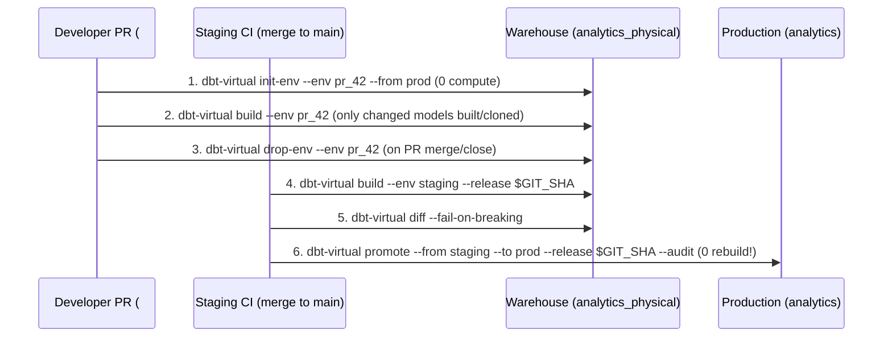

# CI/CD & Production Workflows

This guide shows recommended GitHub Actions / GitLab CI patterns for running `dbt-virtual` across **Pull Requests**, **Staging**, **Zero-Rebuild Production Promotion**, and **Scheduled Garbage Collection**.

---

## 1. End-to-End CI/CD Flow



---

## 2. Pull Request Workflow (Ephemeral `pr_<number>` Environment)

When a developer opens Pull Request `#42`:
1. Bootstrap `analytics_pr_42` from `prod` in **zero compute**.
2. Build only the modified models (with incremental models automatically cloned from `prod` via `CLONE`).
3. Verify schema compatibility (`dbt-virtual diff`).

```bash
export PR_ENV="pr_${GITHUB_EVENT_NUMBER}"

# 1. Compile manifest
dbt compile --target staging --vars "{dbt_virtual: {environment: ${PR_ENV}}}"

# 2. Export live warehouse state so the planner knows which physical tables already exist
dbt-virtual status --env "${PR_ENV}" --base-env prod --output state.json

# 3. Inspect the plan
dbt-virtual plan --env "${PR_ENV}" --base-env prod --state-file state.json

# 4. Build in pr_42 (unchanged models are REUSED in 0 compute!)
dbt-virtual build --env "${PR_ENV}" --base-env prod --state-file state.json --release "pr_${GITHUB_EVENT_NUMBER}_${GITHUB_SHA::8}"
```

When the Pull Request is closed or merged, tear down the ephemeral environment:
```bash
dbt-virtual drop-env --env "pr_${GITHUB_EVENT_NUMBER}"
```

---

## 3. Staging Build & Zero-Rebuild Production Promotion

When code merges to `main`:

```bash
export RELEASE_ID="rel_${GITHUB_SHA::12}"

# 1. Acquire a concurrency lease lock on staging
dbt run-operation virtual_acquire_lock --args "{env: staging, owner: '${GITHUB_RUN_ID}', ttl_minutes: 30}"

# 2. Compile & fetch live state
dbt compile --target staging
dbt-virtual status --env staging --base-env prod --output state.json

# 3. Build candidate release in staging
dbt-virtual build \
  --env staging \
  --base-env prod \
  --state-file state.json \
  --release "${RELEASE_ID}"

# 4. Release staging lock
dbt run-operation virtual_release_lock --args "{env: staging, owner: '${GITHUB_RUN_ID}'}"

# 5. Acquire prod lock, audit & promote release to prod with zero table rebuild!
dbt run-operation virtual_acquire_lock --args "{env: prod, owner: '${GITHUB_RUN_ID}', ttl_minutes: 15}"

dbt-virtual promote \
  --from staging \
  --to prod \
  --release "${RELEASE_ID}" \
  --audit \
  --max-row-drop-pct 20.0

dbt run-operation virtual_release_lock --args "{env: prod, owner: '${GITHUB_RUN_ID}'}"
```

---

## 4. Scheduled Janitor Garbage Collection

Run a daily or weekly scheduled job to clean up old physical tables outside your retention policy (`retention_releases: 5`, `retention_days: 7`):

```bash
dbt-virtual gc --retention-releases 5 --retention-days 7
```
