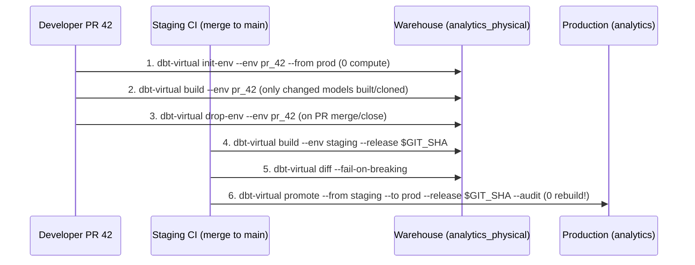

# CI/CD & Production Workflows

This guide shows recommended GitHub Actions / GitLab CI patterns for running `dbt-virtual` across **Pull Requests**, **Staging**, **Zero-Rebuild Production Promotion**, and **Scheduled Garbage Collection**.

---

## 1. End-to-End CI/CD Flow



---

## 2. Pull Request Workflow (Ephemeral `pr_<number>` Environment)

When a developer opens Pull Request `#42`:
1. Bootstrap `analytics_pr_42` from `prod` in **zero compute**.
2. Build only the modified models (with incremental models automatically cloned from `prod` via `CLONE`).
3. Verify schema compatibility (`dbt-virtual diff`).

`dbt-virtual plan` and `build` pass `--env` to dbt as `--target`, so the CI job's `profiles.yml` needs an output named after the PR environment (for example, generate it in the job with the same settings as your CI output). Its `schema` only matters for non-virtual models; virtual objects go to `analytics_pr_42` (`<prod default schema>_<env>`). Because fingerprints no longer depend on the target's datasets, models unchanged in the PR are `REUSE` of prod's tables.

```bash
export PR_ENV="pr_${GITHUB_EVENT_NUMBER}"

# 1. Point the PR environment at prod in 0 compute
dbt-virtual init-env --env "${PR_ENV}" --from prod

# 2. Export live warehouse state so the planner knows which physical tables already exist
dbt-virtual status --env "${PR_ENV}" --base-env prod --output state.json

# 3. Inspect the plan (runs dbt compile --target "${PR_ENV}")
dbt-virtual plan --env "${PR_ENV}" --state-file state.json

# 4. Build in pr_42 (unchanged models are REUSED in 0 compute!)
dbt-virtual build --env "${PR_ENV}" --state-file state.json --release "pr_${GITHUB_EVENT_NUMBER}_${GITHUB_SHA::8}"
```

Do not select the environment with `--vars "{dbt_virtual: {environment: ...}}"`: `--vars` replaces the whole `dbt_virtual` mapping, dropping `physical_schema`, `env_schemas` and the rest. `dbt-virtual build --env` sets `_dbt_virtual_env` instead.

When the Pull Request is closed or merged, tear down the ephemeral environment:
```bash
dbt-virtual drop-env --env "pr_${GITHUB_EVENT_NUMBER}"
```

---

## 3. Staging Build & Zero-Rebuild Production Promotion

When code merges to `main`:

```bash
export RELEASE_ID="rel_${GITHUB_SHA::12}"

# 1. Acquire a concurrency lease lock on staging
dbt run-operation virtual_acquire_lock --args "{env: staging, owner: '${GITHUB_RUN_ID}', ttl_minutes: 30}"

# 2. Fetch live state (build compiles the project itself)
dbt-virtual status --env staging --base-env prod --output state.json

# 3. Build candidate release in staging
dbt-virtual build \
  --env staging \
  --state-file state.json \
  --release "${RELEASE_ID}"

# 4. Release staging lock
dbt run-operation virtual_release_lock --args "{env: staging, owner: '${GITHUB_RUN_ID}'}"

# 5. Audit & promote release to prod with zero table rebuild!
#    promote takes and releases the prod lease lock itself.
dbt-virtual promote \
  --from staging \
  --to prod \
  --release "${RELEASE_ID}" \
  --audit \
  --max-row-drop-pct 20.0 \
  --lock-owner "${GITHUB_RUN_ID}"
```

If the job already holds the `prod` lock (acquired with `virtual_acquire_lock`), pass the same owner with `--lock-owner`: with a different owner, `promote`'s own lock request loses to the older lease and fails.

---

## 4. Scheduled Janitor Garbage Collection

Run a daily or weekly scheduled job to clean up old physical tables outside your retention policy (`retention_releases: 5`, `retention_days: 7`):

```bash
dbt-virtual gc --retention-releases 5 --retention-days 7
```
