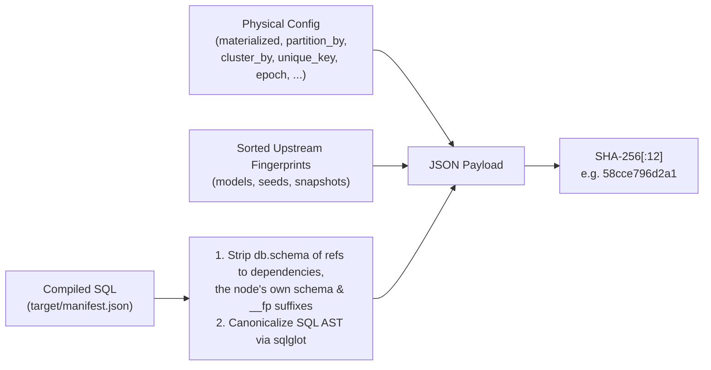

# How It Works & Architecture

`dbt-virtual` brings **SQLMesh's Virtual Data Environments** into standard dbt by separating **Physical Storage** from **Virtual Environment Views & Routines**.

---

## 1. Two-Layer Architecture

### Layer 1: Immutable Physical Storage (`analytics_physical`)
Every `table` or `incremental` model with `virtual_env: true` is materialized in a single shared schema (`physical_schema`, `"analytics_physical"` in these guides) using a **content-addressed table name**:

```text
analytics_physical.<model_name>__<12_char_fingerprint>
```

For example:
- `analytics_physical.orders_metrics__58cce796d2a1`
- `analytics_physical.orders_metrics__2b8f65b7f303`

Because the fingerprint is a hash of the model's canonicalized SQL, physical configuration, and all upstream parent fingerprints:
- **Two environments with the same code share the exact same physical table** (`REUSE` in 0 compute).
- **Modifying a model in `staging` or a PR creates a new physical table** (`orders_metrics__2b8f65b7f303`) without touching `prod`'s physical table (`orders_metrics__58cce796d2a1`).

### Layer 2: Virtual Environment Schemas (`analytics_staging`, `analytics`, `analytics_pr_42`)
Consumers (BI dashboards, analysts, downstream queries, TVFs) never query `analytics_physical` directly. They query clean, stable names in the environment's schema:
- Staging: `analytics_staging.orders_metrics`
- Production: `analytics.orders_metrics`
- PR #42: `analytics_pr_42.orders_metrics`

Each of those is a lightweight `VIEW`:
```sql
CREATE OR REPLACE VIEW `analytics`.`orders_metrics` AS
SELECT * FROM `analytics_physical`.`orders_metrics__58cce796d2a1`
```

An environment can expose its objects in **one schema per custom schema** (`config(schema='gold')` → `analytics_gold` in prod, while staging keeps everything in `analytics_staging`). The mapping lives in [`env_schemas`](configuration_reference.md); physical tables stay in `physical_schema` either way.

---

## 2. Merkle-DAG Fingerprinting

How does `dbt-virtual` compute `<fingerprint>` so that compiling under `staging`, a PR target, or `prod` produces the **exact same hash**?



1. **Target-Schema Invariance**:
   dbt renders every `ref()` as `database.schema.identifier`, and the schema differs per target (a dev or PR dataset vs the prod datasets). Before hashing, `normalize_sql()` replaces the database and schema of every **three-part** reference to a dependency (a model, seed or snapshot the node depends on) with a fixed token, strips the node's own schema, and removes existing `__<fp>` suffixes. The dependency's location does not need to be in the hash: its own fingerprint already is.
2. **AST Canonicalization (`sqlglot`)**:
   Formatting differences, comments (`/* ... */`, `-- ...`), keyword casing (`select` vs `SELECT`), and whitespace are normalized into a canonical SQL AST, in the dialect of the manifest's adapter.
3. **Metadata vs Data Separation**:
   Only configs that change the physical table or routine are hashed: `materialized`, `incremental_strategy`, `unique_key`, `partition_by`, `cluster_by`, `parameters`, `returns`, `virtual_env_epoch`, `physical_version`, and, only when set, `require_partition_filter`, `partition_expiration_days`, `incremental_predicates`, `predicates`, `merge_update_columns`, `merge_exclude_columns`, `sql_header`, your own `pre-hook` / `post-hook` SQL, and enforced contract column types. `forward_only` and `on_schema_change` describe how later runs treat the table, not what it contains, so they are left out (as in SQLMesh; commit `8a3743d`). Changing model descriptions, owners, or tags **never** invalidates a physical table.
4. **Merkle-DAG Upstream Propagation**:
   Every node's hash payload includes `upstream_fingerprints: {parent_id: parent_fp}` for its models (virtual or not), seeds and snapshots. A seed contributes its CSV checksum, so editing a seed changes the fingerprint of every model that reads it. If anything upstream changes, all downstream fingerprints update automatically.

### Same fingerprint in dev, PR and prod

Since points 1 and 4 above (commit `48d2c41`), the same model gets the same fingerprint whatever target compiled it (`tests/test_fingerprint.py::test_ref_locations_do_not_change_fingerprints_across_environments`). That is what lets a PR environment reuse prod's tables and a promotion move pointers instead of rebuilding.

`--known-schema <name>` (on `plan`, `build` and `adopt`) is now only needed when compiled SQL contains a schema name that is **not** the location of a dependency and that differs per target, for example:
- a hard-coded `analytics_staging.lookup` or `{{ target.schema }}_raw.events` written in SQL instead of a `ref()`;
- a hand-written two-part reference (`schema.table`) to a model: the automatic rule only rewrites three-part names, because a two-part name may be `alias.column`.

Pass every per-target value of such a schema, e.g. `--known-schema analytics_staging_raw --known-schema analytics_raw`.

### Why the same code can still get two fingerprints, and how to see it

Measured 2026-11-05 on the flipto-dbt pilot (`dbt compile --select +tag:dbt_virtual`, target `prod_oauth` vs the sandbox target `dbt_virtual_pilot` with `--defer`): the normalized SQL of the four pilot objects was identical in both. What differed was 14 non-virtual ancestors in their upstream closure, all but one `incremental`, so each pilot fingerprint (a hash over its parents' fingerprints) differed. Their compiled SQL depends on the warehouse and the clock, not on the code: `is_incremental()` is true only where the table exists, `snowplow_utils` macros render `CAST(TRUE AS BOOL)` vs `TRUE`, a `run_query` result is inlined as a timestamp literal, `{{ this }}` is `db.schema.alias` of wherever the table lives. Four rules follow, all in `compute_manifest_fingerprints`:

1. **Ancestors dbt-virtual does not build hash raw SQL plus their macro closure, not compiled SQL.** For non-virtual models and snapshots the payload carries `macro_closure_hash`: the `macro_sql` of every macro the node calls, transitively, except dbt's, the adapters' and dbt-virtual's own (a dbt upgrade must not rebuild everything). Editing the model, a macro it calls, or any of its parents still changes the downstream fingerprint (SQLMesh also hashes the model definition and its macro code, not a warehouse-dependent rendering). What is *not* seen: a `var()` value or a `` branch inside a non-virtual ancestor. `--hash-compiled-ancestors` (on `plan`, `build`, `run`, `adopt`) restores hashing their compiled SQL.
2. **Virtual nodes still hash compiled SQL**, so a `target.name` branch or a var in a virtual model changes its fingerprint. That is intended: the behaviour differs.
3. **A node's own `{{ this }}`, dependencies and `source()` relations lose their `db.schema` qualifier**, including when `--defer` pointed a parent at prod. Remaining qualified names (hard-coded tables, a project id written in SQL) stay in the hash: they are logic.
4. **A manifest without compiled SQL is refused.** After `dbt parse` or `dbt run-operation` the manifest has no `compiled_code`; `plan --skip-compile` used to hash the raw SQL only and print a different fingerprint than after a compile. It now exits with "no compiled SQL" for a virtual node whose raw SQL has Jinja. Omit `--skip-compile`.

Not measured: a *virtual* `incremental` model also compiles differently once its table exists (`is_incremental()`); the pilot has none. Treat it as open.

To see why two environments disagree, compare the output of

```bash
dbt-virtual plan --env <env> --target <target> --explain-fingerprint <model> --explain-ancestors
```

in each: it prints, per node, the fingerprint, what was hashed (`compiled_sql` or `raw_sql_and_macros`), the config, the upstream fingerprints, the normalized SQL, and tokens that may differ per environment (qualified relations that are not dependencies, clock functions, timestamp literals). Diff the two outputs; the first ancestor whose line differs is the cause.

### Bare `dbt run` uses a different fingerprint

The fingerprint above is computed by the Python CLI and handed to dbt as `--vars '{_dbt_virtual_fps: ...}'`. A bare `dbt run` / `dbt build` has no such map, so the physical name comes from a Jinja fallback that dbt evaluates while parsing, before parents are resolved: it hashes the model's own raw SQL and a few configs, not its parents, and with a different algorithm. Changing an upstream model then does not give downstream models a new physical table, and the names do not match the CLI's ([tech debt `bare_dbt_run_parse_time_fingerprint`](../tech_debt/bare_dbt_run_parse_time_fingerprint.md)). The two names cannot be made equal: the Jinja fallback runs at parse time, before the manifest, parents and compiled SQL exist (pilot, 2026-11-04: `slv_web__imported_transactions__b17401f52861` from a bare `dbt build`, `__c4a89e19cc97` from `dbt-virtual build`). Build virtual models with `dbt-virtual build`. To enforce that, set [`require_cli_fingerprints: true`](configuration_reference.md): a bare `dbt run` / `dbt build` / `dbt retry` that selects a virtual `table` / `incremental` model then fails in `on-run-start`, before anything is built.

---

## 3. Plan Action Classification

When you run `dbt-virtual plan --env staging --state-file state.json`, each virtualized node is classified into one of 4 actions:

| Action | Condition | Compute Cost |
|---|---|---|
| **`REUSE`** | Physical table `<model>__<fp>` already exists in `analytics_physical` and is registered (an environment or release points at it, i.e. a build finished writing it); for a routine, the same fingerprint is already active in the target environment | **0 table compute** (only syncs the environment `VIEW`) |
| **`SEED_INCREMENTAL`** | `materialized='incremental'`, `<model>__<fp>` does not exist yet, and `base_environment` (`prod`) has an active physical table `<model>__<prod_fp>` | **Delta-only compute** (zero-copy `CLONE` from `prod_fp` + incremental merge) |
| **`FULL_BUILD`** | Brand-new model, changed `table` model, `--full-refresh`, or `virtual_env_epoch` bumped with no base table | Standard table build |
| **`ROUTINE_DEPLOY`** | `table_function`, `virtual_function`, `function`, or `procedure` whose fingerprint is not active in the target environment | Metadata DDL only (`CREATE OR REPLACE ...`) |

The planner only knows what exists in the warehouse through the state file written by `dbt-virtual status --output state.json`. Without `--state-file`, nothing is `REUSE` or `SEED_INCREMENTAL`. The state file lists both the physical tables that exist and the ones the registry points at (`registered_physical_tables`); a table that exists but is not registered, such as a clone whose `dbt build` then failed, is rebuilt instead of reused.

---

## 4. Releases, Promotion & Rollback

### What a release contains
`dbt-virtual build --release R` records release `R` in `_releases`. Hooks add a row for every model and routine dbt built; at the end, `virtual_snapshot_release` adds the environment's current pointer for every other virtual node in the project (REUSE tables, unchanged routines, models outside `--select`). A release therefore describes the **whole environment**, and promoting or rolling back to it does not drop unchanged objects (`tests/test_dbt_duckdb_regressions.py::test_partial_release_promote_and_rollback_keep_unchanged_models`).

### Promotion order
`virtual_promote` deploys the release in this order:

1. **Environment views** (`model`): `CREATE OR REPLACE VIEW <env_schema>.<model> AS SELECT * FROM <physical_schema>.<model>__<fp>`. They depend on no routine, and routines may read them (BigQuery and DuckDB check referenced tables when a routine is created).
2. **Routines in DAG order**: each routine after the virtual views and routines it reads (by its depth in the project's DAG); routines at the same depth go scalar UDFs (`virtual_function` / `function`), then table functions (`table_function`), then procedures (`procedure`), then by name.

When called from the CLI, `promote` (and `rollback`) first take the environment's lease lock in `_locks` and release it at the end (`--no-lock` to skip). Objects whose fingerprint and location are already active in the target environment are skipped (partial promotion). Each routine's stored DDL template is resolved for the target environment: every reference to a virtual object is pointed at that object's schema in the target environment. An object that was active in the target but is not in the release is **demoted** (dropped) only if it is no longer a virtual node in the project.

### Data diff (`virtual_data_diff`, `dbt-virtual diff-data`)
A row-level comparison of a candidate table with the baseline, by checksum bisection (the approach of Datafold data-diff and reladiff) instead of a full join:

1. **Segment checksums.** One grouped query per side returns `COUNT(*)` and an order-independent hash aggregate per segment: a partition (BigQuery `partition_by`; `diff_partition_by` elsewhere), or the whole table. BigQuery uses `BIT_XOR(FARM_FINGERPRINT(TO_JSON_STRING(STRUCT(<columns>))))`, DuckDB `bit_xor(hash(...))`, Snowflake `BITXOR_AGG(HASH(...))`, Databricks `bit_xor(xxhash64(...))`, PostgreSQL `bit_xor(hashtextextended(ROW(...)::text, 0))`.
2. **Bisection.** A segment whose count or hash differ and that holds more than `--threshold` rows is split into `--branching` key ranges (one grouped query per side per split segment); only the ranges that differ are split again.
3. **Leaf join.** The small differing ranges are joined on the key (`FULL OUTER JOIN`) to count rows only in the candidate, only in the target and changed rows, with a mismatch count per column and a sample.

Identical tables stop after step 1: one checksum query per side, no join (`queries.join_queries` is `0` in the JSON). `diff_exclude_columns` removes columns from the hash and the comparison; `diff_where` / `--where` / `--window-days` bound the rows read.

Cost. Each query reads only the compared columns, once per side per segment per level, and only for segments that still differ; identical segments are never read again. On BigQuery the bytes billed are about the size of the compared columns of the rows in the scanned segments: a partition filter prunes the rest, and the first level reads every selected partition once per side. Not measured on BigQuery: run it first with `--window-days` on a large table and compare the logged `queries` counts with the job's bytes billed.

Limits: a model needs a unique key (`unique_key` / `diff_key`) to be drilled, and range bisection needs a numeric key; duplicated keys make the join overcount. `BIT_XOR` cancels pairs of identical rows, so a pair of duplicate rows added to one side changes the count but not the hash. Tables with `require_partition_filter` need `diff_where` or `--window-days`.

### Rollback
`virtual_rollback` first checks that every physical table of the target release still exists (GC may have dropped it) and stops before changing anything if one is missing. It then re-points views and redeploys routines of the target release in the same order, removes active objects that are not in that release, and marks the undone releases `rolled_back`. A second `dbt-virtual rollback --env prod` therefore goes one release further back instead of returning to the same one.

---

## 5. State Registry Tables in `analytics_physical`

`dbt-virtual` stores all state directly inside your warehouse in `analytics_physical`, requiring **no external database or Redis server**. The tables are created the first time they are needed; a registry created by an older version gets the `schema_key` column added automatically. Registry DDL only runs when a table is missing or lacks `schema_key` (it used to run for every model, one extra BigQuery job per model).

### `analytics_physical._environments`
Tracks the currently active fingerprint and physical identifier for every model/routine in each environment:

| Column | Type | Example |
|---|---|---|
| `environment` | `STRING` | `'prod'` |
| `model_name` | `STRING` | `'orders_metrics'` |
| `resource_type` | `STRING` | `'model'` (or `'function'`, `'table_function'`, `'procedure'`) |
| `fingerprint` | `STRING` | `'58cce796d2a1'` |
| `physical_identifier` | `STRING` | `'analytics_physical.orders_metrics__58cce796d2a1'` |
| `release_id` | `STRING` | `'v2026.10.27'` |
| `updated_at` | `TIMESTAMP` | `2026-10-27 22:00:00 UTC` |
| `schema_key` | `STRING` | `'gold'` (the object's custom schema; `NULL` = default schema) |

### `analytics_physical._releases`
Immutable audit log of every release built or promoted, with `status` (`candidate`, `promoted`, `rolled_back`), `schema_key`, a `dependency_tier` (`1` function, `2` model, `3` table function, `4` procedure), and parameterized `routine_ddl_template` strings so any release can be promoted or rolled back without running `dbt compile` again. Templates use one placeholder per referenced object's custom schema (`__DBT_VIRTUAL_ENV_SCHEMA_<schema_key>__`, or `__DBT_VIRTUAL_ENV_SCHEMA__` for the default schema).

### `analytics_physical._locks`
TTL-backed concurrency lease table (`environment`, `owner`, `acquired_at`, `expires_at`) used by `virtual_acquire_lock` / `virtual_release_lock` (and by CLI `promote` / `rollback`) to prevent concurrent jobs from mutating the same environment simultaneously. A runner drops expired leases, writes its own, then reads all live leases: the oldest one wins and the others remove theirs and fail, so two runners cannot both hold the lock.

### `analytics_physical._intervals`
Tracks processed `[start_ts, end_ts]` backfill intervals per `(model_name, fingerprint)` when `--start` and `--end` are passed to `dbt-virtual build`.

---

## 6. Known Limitations

- **Bare `dbt run`** cannot put upstream fingerprints in physical names (section 2). Use `dbt-virtual build`, and set `require_cli_fingerprints: true` to make bare runs of virtual tables fail.
- **`view` models** with `virtual_env: true` are created in the environment schema by dbt, but no pointer or release row is recorded for them (`sync_env_view` only handles `table` / `incremental`), so `promote` and `rollback` do not move them. Build them in each environment, or keep views out of `virtual_env`.
- **Routines that read non-virtual models** keep the location of those models from the environment that built them; only references to virtual objects are re-pointed on promote. Make a routine's dependencies virtual (or sources).
- **DuckDB table functions** use dbt-duckdb's own `table_function` materialization, so they are not virtualized ([Warehouse Support](warehouse_support.md)).
