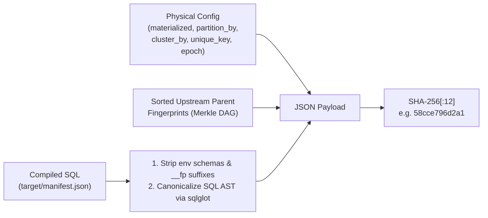

# How It Works & Architecture

`dbt-virtual` brings **SQLMesh's Virtual Data Environments** into standard dbt by separating **Physical Storage** from **Virtual Environment Views & Routines**.

---

## 1. Two-Layer Architecture

### Layer 1: Immutable Physical Storage (`analytics_physical`)
Every `table` or `incremental` model with `virtual_env: true` is materialized in a single shared schema (`physical_schema`, default `"analytics_physical"`) using a **content-addressed table name**:

```text
analytics_physical.<model_name>__<12_char_fingerprint>
```

For example:
- `analytics_physical.orders_metrics__58cce796d2a1`
- `analytics_physical.orders_metrics__2b8f65b7f303`

Because the fingerprint is a cryptographic hash of the model's canonicalized SQL, physical configuration, and all upstream parent fingerprints:
- **Two environments with the same code share the exact same physical table** (`REUSE` in 0 compute).
- **Modifying a model in `staging` or a PR creates a new physical table** (`orders_metrics__2b8f65b7f303`) without touching `prod`'s physical table (`orders_metrics__58cce796d2a1`).

### Layer 2: Virtual Environment Schemas (`analytics_staging`, `analytics`, `analytics_pr_42`)
Consumers (BI dashboards, analysts, downstream queries, TVFs) never query `analytics_physical` directly. They query clean, stable names in the environment's schema:
- Staging: `analytics_staging.orders_metrics`
- Production: `analytics.orders_metrics`
- PR #42: `analytics_pr_42.orders_metrics`

Each of those is a lightweight `VIEW`:
```sql
CREATE OR REPLACE VIEW `analytics`.`orders_metrics` AS
SELECT * FROM `analytics_physical`.`orders_metrics__58cce796d2a1`
```

---

## 2. Merkle-DAG Fingerprinting

How does `dbt-virtual` compute `<fingerprint>` so that compiling under `staging` and compiling under `prod` produce the **exact same hash**?



1. **Target-Schema Invariance**:
   Whether dbt compiled a query with `analytics_staging.stg_orders` or `analytics.stg_orders`, `normalize_sql()` strips known environment schemas and existing `__<fp>` suffixes before parsing.
2. **AST Canonicalization (`sqlglot`)**:
   Formatting differences, comments (`/* ... */`, `-- ...`), keyword casing (`select` vs `SELECT`), and whitespace are normalized into a canonical SQL AST.
3. **Metadata vs Data Separation**:
   Only physical-shape configs (`materialized`, `incremental_strategy`, `unique_key`, `partition_by`, `cluster_by`, `on_schema_change`, `parameters`, `returns`, `virtual_env_epoch`, `forward_only`, `physical_version`) are included in the hash. Changing model descriptions, owners, or tags **never** invalidates a physical table!
4. **Merkle-DAG Upstream Propagation**:
   Nodes are hashed in topological order (`Kahn's algorithm`). Every node's hash payload includes `upstream_fingerprints: {parent_id: parent_fp}`. If an upstream table changes, all downstream dependent fingerprints update automatically.

---

## 3. Plan Action Classification

When you run `dbt-virtual plan --env staging`, each virtualized node is classified into one of 4 actions:

| Action | Condition | Compute Cost |
|---|---|---|
| **`REUSE`** | Physical table `<model>__<fp>` already exists in `analytics_physical` | **0 table compute** (only syncs the environment `VIEW`) |
| **`SEED_INCREMENTAL`** | `materialized='incremental'`, `<model>__<fp>` does not exist yet, and `base_environment` (`prod`) has an active physical table `<model>__<prod_fp>` | **Delta-only compute** (zero-copy `CLONE` from `prod_fp` + incremental merge) |
| **`FULL_BUILD`** | Brand-new model, `materialized='table'`, or `virtual_env_epoch` bumped with no base table | Standard table build |
| **`ROUTINE_DEPLOY`** | `table_function`, `function`, or `procedure` | Metadata DDL only (`CREATE OR REPLACE ...`) |

---

## 4. State Registry Tables in `analytics_physical`

`dbt-virtual` stores all state directly inside your warehouse in `analytics_physical`—requiring **no external database or Redis server**:

### `analytics_physical._environments`
Tracks the currently active fingerprint and physical identifier for every model/routine in each environment:

| Column | Type | Example |
|---|---|---|
| `environment` | `STRING` | `'prod'` |
| `model_name` | `STRING` | `'orders_metrics'` |
| `resource_type` | `STRING` | `'model'` (or `'function'`, `'table_function'`, `'procedure'`) |
| `fingerprint` | `STRING` | `'58cce796d2a1'` |
| `physical_identifier` | `STRING` | `'analytics_physical.orders_metrics__58cce796d2a1'` |
| `release_id` | `STRING` | `'v2026.10.27'` |
| `updated_at` | `TIMESTAMP` | `2026-10-27 22:00:00 UTC` |

### `analytics_physical._releases`
Immutable audit log of every release built or promoted, including parameterized `routine_ddl_template` strings (`__DBT_VIRTUAL_ENV_SCHEMA__`) and `dependency_tier` (`1..4`) so any release can be promoted or rolled back without running `dbt compile` again.

### `analytics_physical._locks`
TTL-backed concurrency lease table (`environment`, `owner`, `acquired_at`, `expires_at`) used by `virtual_acquire_lock` / `virtual_release_lock` to prevent concurrent jobs from mutating the same environment simultaneously.

### `analytics_physical._intervals`
Tracks processed `[start_ts, end_ts]` backfill intervals per `(model_name, fingerprint)` when `--start` and `--end` are passed to `dbt-virtual build`.
