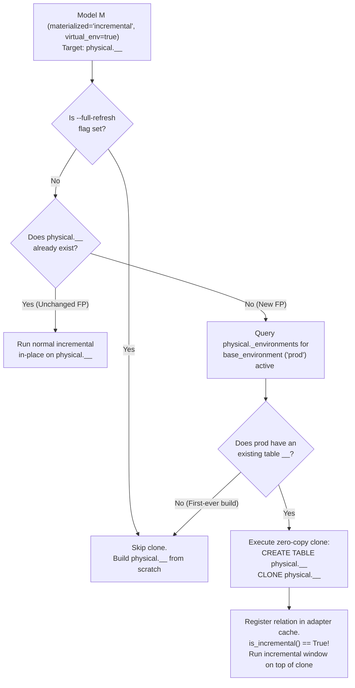

# SPEC 02: Routing, `ref()` Resolution Modes, and Zero-Copy `CLONE` Seeding

- **Status**: Draft v1.0
- **Component**: `macros/routing/` & `macros/lifecycle/`

---

## 1. Physical vs. Virtual Naming Contract

For every model $M$ with `virtual_env: true`:

| Concept | Schema | Identifier | Example (BigQuery) |
|---|---|---|---|
| **Physical Table** | `var('dbt_virtual').physical_schema` | `<model_name>__<fp>` | `spacetime_physical.traffic_metrics_root__8f3a9c1b2d4e` |
| **Staging Virtual View** | `env_schemas['staging']` | `<model_name>` | `spacetime_staging.traffic_metrics_root` |
| **Prod Virtual View** | `env_schemas['prod']` | `<model_name>` | `spacetime.traffic_metrics_root` |
| **Ephemeral PR View** | `rt_pipeline_pr_<N>` | `<model_name>` | `rt_pipeline_pr_509.traffic_metrics_root` |

Models that do **not** set `virtual_env: true` bypass `dbt-virtual` completely and use the project's standard `generate_schema_name` and `generate_alias_name` logic.

---

## 2. `ref()` Resolution Modes (Default: Option A + Future Modes)

When model or routine $B$ references a virtualized model $A$ via `{{ ref('A') }}`, `dbt-virtual` intercepts `builtins.ref` only if node $A$ has `virtual_env: true`.

### 2.1 Mode A (`ref_resolution: "env_view"` — Default in v1)
- **Resolution**: `{{ ref('A') }}` returns a `Relation` pointing to `<current_env_schema>.A` (the virtual environment view), while $A$'s own `this` during its materialization points to `<physical_schema>.A__<fp_A>`.
- **Properties**:
  - Downstream views and BigQuery routines (`CREATE TABLE FUNCTION`, `CREATE FUNCTION`, `CREATE PROCEDURE`) compile against the stable environment view `<env_schema>.A`.
  - When `A` is promoted or rolled back by swapping the view `<env_schema>.A` to a different physical table `A__<fp_prev>`, every downstream view and TVF in that environment immediately reads the updated table without recompilation.
  - Zero changes needed in BI tools, ad-hoc queries, or downstream non-virtualized models.

### 2.2 Mode B (`ref_resolution: "physical"` — Supported Alternative)
- **Resolution**: `{{ ref('A') }}` returns `<physical_schema>.A__<fp_A>`.
- **Properties**:
  - Downstream tables bind directly to the immutable physical table `A__<fp_A>` that existed at compile time.
  - Environment views `<env_schema>.A` still exist for external consumers (Looker, Platform API, analysts).
  - *Trade-off*: Promoting or rolling back `A` requires re-executing `CREATE OR REPLACE TABLE FUNCTION` for any TVF that references `A` directly.

### 2.3 Mode C (`ref_resolution: "hybrid"` — Supported Alternative)
- **Resolution**:
  - If the caller $B$ is a `table` or `incremental` model, `{{ ref('A') }}` resolves to `<physical_schema>.A__<fp_A>` (strict physical lineage).
  - If the caller $B$ is a serving routine (`table_function`, `function`, `procedure`) or `view`, `{{ ref('A') }}` resolves to `<env_schema>.A` (instant view-swap serving).

### 2.4 Mode D (`ref_resolution: "explicit"` — Opt-in Macro Only)
- **Resolution**: Standard `{{ ref('A') }}` is never overridden; users call `{{ dbt_virtual.virtual_ref('A') }}` explicitly where virtual routing is desired.

---

## 3. Zero-Copy `CLONE` Incremental Seeding

### 3.1 The Incremental Cold-Start Problem in Content-Addressed Tables
In standard dbt, an incremental model writes to a single mutable table (`spacetime.traffic_metrics_root`). When a developer modifies the SQL of an incremental model under content-addressed storage, its fingerprint changes from `<fp_old>` to `<fp_new>`, meaning `<physical_schema>.<model>__<fp_new>` **does not exist yet**.
Without seeding, dbt would see `adapter.get_relation(this) == None`, set `is_incremental() = False`, and trigger an expensive multi-terabyte full refresh from the beginning of time!

### 3.2 How `dbt-virtual` Solves It with Zero-Copy `CLONE`
Before an `incremental` model with `virtual_env: true` runs (and before `is_incremental()` is evaluated when seeded via `dbt-virtual build` or custom pre-step):



### 3.3 BigQuery Cost & Semantics of `CREATE TABLE ... CLONE`
- **Creation time**: Metadata-only operation (~1–3 seconds regardless of table size).
- **Storage cost**: Zero initial bytes billed; BigQuery only bills for partitions/blocks modified after the clone diverges from `<M>__<fp_base>`.
- **Partitioning & Clustering**: Preserved identically from `<M>__<fp_base>`.

---

## 4. Virtual View Publication (`sync_env_view`)

As a `post_hook` on every virtualized `table` / `incremental` model:
1. Creates or replaces the environment view:
   ```sql
   CREATE OR REPLACE VIEW `<project>.<env_schema>.<model_name>` AS
   SELECT * FROM `<project>.<physical_schema>.<model_name>__<fp>`;
   ```
2. Upserts the pointer row in `<physical_schema>._environments`:
   ```sql
   MERGE `<project>.<physical_schema>._environments` AS T
   USING (
     SELECT
       '<environment>' AS environment,
       '<model_name>' AS model_name,
       'model' AS resource_type,
       '<fp>' AS fingerprint,
       '<physical_schema>.<model_name>__<fp>' AS physical_identifier,
       '<release_id>' AS release_id,
       CURRENT_TIMESTAMP() AS updated_at
   ) AS S
   ON T.environment = S.environment AND T.model_name = S.model_name
   WHEN MATCHED THEN UPDATE SET
     fingerprint = S.fingerprint,
     physical_identifier = S.physical_identifier,
     release_id = S.release_id,
     updated_at = S.updated_at
   WHEN NOT MATCHED THEN INSERT ROW;
   ```
