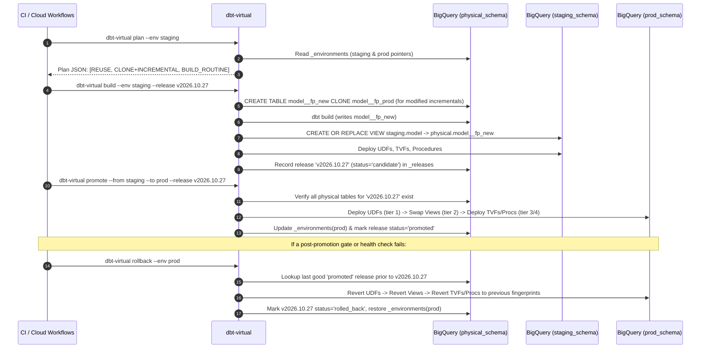

# SPEC 04: Lifecycle Operations, State Registry, Rollback & Janitor GC

- **Status**: Draft v1.0
- **Component**: `src/dbt_virtual/cli.py`, `src/dbt_virtual/registry.py`, & `macros/lifecycle/`

---

## 1. State Registry DDL (`<physical_schema>`)

`dbt-virtual` maintains two metadata tables in `<physical_schema>` (auto-created by `dbt_virtual.ensure_registry_tables()`):

### 1.1 `<physical_schema>._environments`
Stores the live pointer state for every environment (`staging`, `prod`, `pr_N`):

```sql
CREATE TABLE IF NOT EXISTS `<project>.<physical_schema>._environments` (
  environment STRING NOT NULL,
  model_name STRING NOT NULL,
  resource_type STRING NOT NULL,       -- 'model' | 'table_function' | 'function' | 'procedure'
  fingerprint STRING NOT NULL,         -- 12-char sha256 hex
  physical_identifier STRING NOT NULL, -- e.g. 'spacetime_physical.traffic_metrics_root__8f3a9c1b2d4e'
  release_id STRING,                   -- e.g. 'v2026.10.27' or commit sha
  updated_at TIMESTAMP NOT NULL
)
CLUSTER BY environment, model_name;
```

### 1.2 `<physical_schema>._releases`
Stores immutable per-release manifests for zero-rebuild promotion, auditability, and instant rollback:

```sql
CREATE TABLE IF NOT EXISTS `<project>.<physical_schema>._releases` (
  release_id STRING NOT NULL,
  source_environment STRING NOT NULL,  -- e.g. 'staging'
  target_environment STRING,           -- e.g. 'prod' once promoted
  model_name STRING NOT NULL,
  resource_type STRING NOT NULL,
  dependency_tier INT64 NOT NULL,      -- 1=function(UDF), 2=model(view), 3=table_function(TVF), 4=procedure
  fingerprint STRING NOT NULL,
  physical_identifier STRING NOT NULL,
  routine_ddl_template STRING,         -- parameterized CREATE OR REPLACE ... with __DBT_VIRTUAL_ENV_SCHEMA__
  status STRING NOT NULL,              -- 'candidate' | 'promoted' | 'rolled_back' | 'superseded'
  created_at TIMESTAMP NOT NULL,
  promoted_at TIMESTAMP,
  rolled_back_at TIMESTAMP
)
PARTITION BY DATE(created_at)
CLUSTER BY release_id, status;
```

---

## 2. End-to-End Lifecycle Operations



---

## 3. Detailed Operation Specifications

### 3.1 `plan` (`dbt-virtual plan --env <env> [--format text|json]`)
1. Runs `dbt compile` (or reads existing `target/manifest.json` if `--skip-compile` is passed).
2. Computes the Merkle-DAG fingerprint `<fp_new>` for every node with `virtual_env: true`.
3. Queries `<physical_schema>._environments` for `<env>` and `base_environment` (`prod`), plus `INFORMATION_SCHEMA.TABLES` in `<physical_schema>`.
4. Classifies every virtualized node into one of four actions:
   - **`REUSE_EXISTING`**: `<model>__<fp_new>` already exists in `<physical_schema>` and is already pointed to by `<env>`. (Or for incremental scheduled runs: `INCREMENTAL_IN_PLACE`).
   - **`REPOINT_ONLY`**: `<model>__<fp_new>` already exists in `<physical_schema>` (built by another env/run), so `<env>` only needs a view swap.
   - **`CLONE_AND_INCREMENTAL`**: `<model>__<fp_new>` does not exist, model is `incremental`, and `prod` has `<model>__<fp_prod>` available to clone.
   - **`FULL_BUILD`**: `<model>__<fp_new>` does not exist and is a `table`, routine, or first-time `incremental`.

### 3.2 `build` (`dbt-virtual build --env <env> [--release <id>] [--select ...]`)
1. Computes fingerprints and writes `.dbt_virtual/fingerprints.json`.
2. Executes `dbt build` passing `--vars '{"_dbt_virtual_fps": <map>, "_dbt_virtual_env": "<env>", "_dbt_virtual_release": "<id>"}'`.
3. During `dbt build`:
   - `pre_hook` (`dbt_virtual.clone_if_new_fp()`) seeds any new incremental fingerprint from `base_environment` via zero-copy `CLONE`.
   - `post_hook` (`dbt_virtual.sync_env_view()`) updates `<env_schema>.<model>` view and upserts `_environments`.
   - Routine materializations deploy routines to `<env_schema>` and register their tokenized DDLs.
4. On successful completion, records the release candidate in `<physical_schema>._releases`.

### 3.3 `promote` (`dbt-virtual promote --from staging --to prod --release <id>`)
1. Reads all entries for `release_id = <id>` from `<physical_schema>._releases`.
2. **Pre-Flight Verification**: Confirms every referenced physical table `<model>__<fp>` exists in `<physical_schema>.INFORMATION_SCHEMA.TABLES`. If any table is missing, aborts before touching `prod`.
3. Executes promotion in strict `dependency_tier` order:
   - **Tier 1 (`function` / scalar UDFs)**: Executes `CREATE OR REPLACE FUNCTION <prod_schema>.<udf>...`
   - **Tier 2 (`model` / virtual views)**: Executes `CREATE OR REPLACE VIEW <prod_schema>.<model> AS SELECT * FROM <physical_schema>.<model>__<fp>`
   - **Tier 3 (`table_function` / TVFs)**: Executes `CREATE OR REPLACE TABLE FUNCTION <prod_schema>.<tvf>...`
   - **Tier 4 (`procedure` / stored procedures)**: Executes `CREATE OR REPLACE PROCEDURE <prod_schema>.<proc>...`
4. Updates `_environments` for `prod` and marks `release_id` as `promoted` in `_releases`.

### 3.4 `rollback` (`dbt-virtual rollback --env prod [--to-release <id>]`)
1. If `--to-release` is omitted, queries `_releases` for the most recent `status = 'promoted'` release prior to the current active release on `prod`.
2. Executes the exact same Tier 1 → Tier 2 → Tier 3 → Tier 4 promotion sequence using the target rollback release's fingerprints and `routine_ddl_template`s.
3. Marks the broken release `status = 'rolled_back'` with `rolled_back_at = CURRENT_TIMESTAMP()` and updates `_environments`.

### 3.5 `diff` (`dbt-virtual diff --from prod --to staging [--model <name>]`)
For each virtualized table where `fp(prod) != fp(staging)`:
1. Compares row counts, partition counts, and schema column diffs between `<physical_schema>.<model>__<fp_prod>` and `<physical_schema>.<model>__<fp_staging>`.
2. Optionally runs a bounded symmetric `EXCEPT DISTINCT` probe over non-sketch scalar columns or a specified date window.

### 3.6 `gc` (`dbt-virtual gc [--dry-run] [--retention-releases 5] [--retention-days 7]`)
1. Protected set $P$:
   - All `physical_identifier`s currently active in `_environments` (across all environments: `prod`, `staging`, etc.).
   - All `physical_identifier`s referenced by the last $N$ (`retention_releases`) promoted or candidate releases in `_releases`.
2. Queries `<physical_schema>.INFORMATION_SCHEMA.TABLES` for all tables matching `*__[0-9a-f]{12}` whose `creation_time < CURRENT_TIMESTAMP() - INTERVAL <retention_days> DAY`.
3. For any table not in $P$:
   - In `--dry-run` mode: logs the `DROP TABLE` statement and bytes reclaimed.
   - In live mode: executes `DROP TABLE IF EXISTS <physical_schema>.<table>`.
